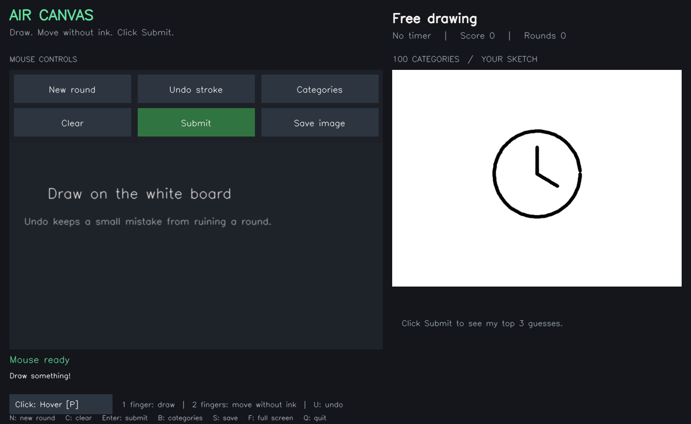

# Air-Canvas Guesser

A touchless Pictionary game: draw with your index finger and let a small neural
network guess the sketch. The game runs locally with **CPU inference**, a webcam,
and a clean black-and-white drawing board.



## Features

- **100 sketch categories** trained on Google Quick, Draw!.
- Larger **800 × 600 camera panel**, with a separate clean drawing board.
- The cursor stays on your detected fingertip; two extended fingers lift the pen.
- Visible controls work with mouse clicks, hover holds, or optional pinch clicks.
- Undo, clear, PNG export, and a category browser that pauses the timer.
- Thirty-second rounds, top-three guesses, scoring, and uncertainty feedback.
- A small trained checkpoint is included, so playing does not require a Kaggle account.

Webcam frames stay on your computer. After installing dependencies and downloading
the hand tracker once, gameplay does not need an internet connection or a paid API.

## Quick start

Tested with **Python 3.12 on Linux**. You need a desktop session and a webcam;
mouse mode works without a camera.

```bash
git clone https://github.com/AbdallahYettou/air-canvas-guesser.git
cd air-canvas-guesser
python3 -m venv .venv
source .venv/bin/activate
python -m pip install -r requirements.txt
python -m pip install -r requirements-cpu.txt
python scripts/download_hand_model.py
python app.py
```

On Windows, activate the environment with `.venv\Scripts\Activate.ps1` in
PowerShell. Windows and macOS have not been tested; the pinned CPU installation
recipe is intended for the tested Linux environment.

The included [sketch checkpoint](models/quickdraw_cnn.pth) recognizes all 100
categories. The download script obtains Google's pretrained hand tracker and
checks its SHA-256. If the sketch checkpoint is missing or incompatible, the app
opens in drawing practice mode and explains that AI guesses are unavailable.

Useful launch options:

```bash
python app.py --fullscreen       # use the full display; F toggles it while playing
python app.py --mouse            # draw with the mouse instead of a webcam
python app.py --practice         # free drawing, without a timer or score
python app.py --camera 1         # try a different camera
python app.py --click-mode pinch # use pinch clicks on the visible controls
```

The window is resizable. Camera processing remains at 640 × 480 for responsive
CPU operation; the preview is enlarged proportionally, with matching pointer and
button coordinates.

## How to play

Click **New round**, draw the requested object, then click **Submit**. The timer
also submits automatically. The first guess matching the target earns 100 points;
a match in second or third place earns 30. Each round scores once.

| Action | Hand / onscreen control | Keyboard |
| --- | --- | --- |
| Draw | Extend your index finger; curl the other fingers | Mouse drag in mouse mode |
| Move without ink | Extend index and middle fingers; lower fingers may relax | Release the mouse |
| Submit | Click or hold over Submit | Enter |
| Clear | Click or hold over Clear | C |
| Undo | Undo the last stroke, or restore a cleared board | U |
| New round | Click or hold over New round | N |
| Categories | Browse the model's labels; the timer pauses | B |
| Click mode | Toggle Hover / Pinch | P |
| Save drawing | Save the white board as a PNG | S |
| Full screen | Toggle full-screen view | F |
| Quit | Close the window | Q / Escape |

Keep your palm upright and visible. Both button rows sit near the top of the
camera view so you can reach them without pushing your palm out of frame.
**Draw below the controls.** The cursor is attached directly to the detected
fingertip; only the drawing strokes are smoothed.

Hovering fills a progress ring. Small movements near button edges are tolerated,
and you must move away after a click before the same button can activate again.
For Pinch mode, point at a button with your thumb and index finger separated, then
pinch them together; release before the next click. Palms and fists only pause.

Undo remembers up to 30 strokes/actions and resets between rounds. The category
browser shows 24 labels per page across five pages, including ranges such as
`1–24 of 100`. Weak or closely tied predictions display **Not sure**; this is a
helpful hint, not a reliable detector for every object outside the trained classes.

## Model and results

Only **Google Quick, Draw!** was used for sketch training: 100 classes and 4,000
recognized drawings per class. A seeded split contains 320,000 training, 40,000
validation, and 40,000 test sketches. The model was chosen on validation accuracy,
then evaluated on the held-out test set. Training ran on a free Kaggle T4 GPU;
local inference uses two CPU threads.

| Model | Parameters | Test top-1 | Test top-3 |
| --- | ---: | ---: | ---: |
| Small CNN | 261,860 | 78.80% | 91.86% |
| **Compact residual network (included)** | **944,324** | **90.44%** | **97.65%** |

A local check measured **2.85 ms median / 3.63 ms p95** per prediction, including
cropping, padding, and resizing, across 100 warm predictions of a synthetic sketch.
This excludes webcam tracking and rendering; it is not a hardware-independent
performance guarantee. Probability temperature was fitted on validation data.

The dataset uses a bounded prefix of recognized drawings per class, not a random
sample of the entire collection. Dataset accuracy does **not** measure real
air-drawing accuracy. Lighting, hand position, stroke quality, and unfamiliar
objects can affect the experience.

- [Full result summary and checkpoint checksum](docs/100-class-results.json)
- [All 100 categories](training/classes.json)
- [Kaggle training and recovery instructions](docs/training.md)

The original Kaggle run is private to its owner. Other users can play with the
included checkpoint or train their own run using the supplied recipe.

## Project structure

```text
app.py                         Desktop game and camera loop
core/                          Tracking, controls, canvas, game, UI, and inference
models/quickdraw_cnn.pth       Included CPU-compatible sketch checkpoint
scripts/download_hand_model.py Download and verify the pretrained hand tracker
scripts/kaggle_job.py           Prepare, submit, inspect, and fetch Kaggle training
training/                      Category list and reproducible training code
tests/                         Automated regression tests
docs/                          Results, training notes, and screenshots
```

The training script and local app share the same model definitions and sketch
preprocessing. Guessing runs in a background worker, and results from an old
round are discarded.

## Development

```bash
python -m pip install -r requirements-dev.txt
python -m pytest -q
python app.py --preview captures/preview.png
```

[requirements-lock.txt](requirements-lock.txt) records the tested Linux/Python 3.12
environment. Add `-c requirements-lock.txt` to the dependency installation commands
to reproduce it. Keep the CPU PyTorch index from `requirements-cpu.txt` when
installing PyTorch.

Only the small inference checkpoint is versioned. Datasets, credentials, the
virtual environment, downloaded hand-model binaries, training recovery files,
and user drawings are ignored by Git.

## Troubleshooting

- **Camera cannot open:** close other camera apps, check OS permissions, and try
  `--camera 1`. Use `--mouse` to check the rest of the game independently.
- **Tracking is unreliable:** use good lighting, show one hand, and keep the palm
  facing the camera. Try Pinch mode with **P** if holding still is difficult.
- **The window feels cramped:** maximize it or press **F** for full screen.
- **No desktop display:** run in a desktop terminal. A remote notebook cannot open
  this local OpenCV window or access your laptop's webcam. `--preview` is headless.
- **The app still shows an old model or layout:** close and restart it after pulling
  changes or replacing a checkpoint.
- **Wrong guesses:** try a larger, simpler outline and check Categories to see
  which objects the model recognizes.

## Credits

- [Google Quick, Draw! dataset](https://github.com/googlecreativelab/quickdraw-dataset),
  licensed under **CC BY 4.0**, supplied the recognized vector sketches used in training.
- [MediaPipe Hand Landmarker](https://developers.google.com/edge/mediapipe/solutions/vision/hand_landmarker)
  provides pretrained hand landmarks; no custom gesture model is required.
- [OpenCV](https://opencv.org/), [PyTorch](https://pytorch.org/), and
  [Kaggle](https://www.kaggle.com/) provide the drawing, inference, and training tools.
